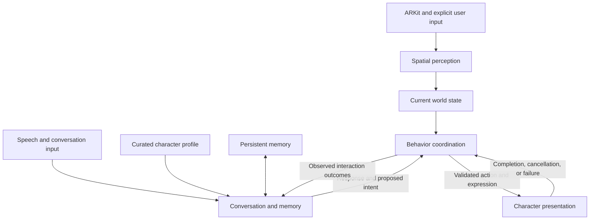

# Architecture

Status: proposed logical architecture with floor preview/confirmation, calibrated sole contact, spatial restoration, character loading, stance/idle, head attention, selected hair physics, and facial previews implemented. The user reported preliminary hair stability and natural facial presentation. Floor acceptance and measured performance remain open. Last updated: 2026-10-31.

## Design intent

Preserve the current native SwiftUI, RealityKit, and ARKit direction while validating the first complete experience. Separate responsibilities where they have different state, timing, or failure modes. These boundaries do not require separate packages, a plugin framework, or a general-purpose agent platform.

## Current spatial implementation

The first D1 experiment uses one app-owned `SpatialPrototype` observable model to coordinate the control window, mixed immersive scene, and an explicit ARKit world-tracking session. This is a focused spatial controller, not the future conversation or behavior system.

- `SpatialPrototypeView` owns scene appearance, disappearance, and active-phase notifications. Each new tracking run creates fresh providers; teardown stops the session and cancels update tasks.
- `SpatialPrototype` gates placement on active, running device tracking and displays the placeholder only while both device and selected world anchor are valid. Session-generation tokens reject obsolete asynchronous results; anchor identity filtering rejects replaced anchors.
- `PlacementGeometry` computes an upright heading-based placement. Manual-height mode uses its vertical offset; floor mode reuses its horizontal target and facing before solving height from a classified floor mesh.
- `FloorDetection` owns plane authorization, copying bounded ARKit buffers, provider-specific state, and live reconciliation. `FloorSurface` owns pure mesh validity/containment/stability; `FloorPlacement` owns live evidence and a frozen preview with explicit confirmation. Neither the detector nor preview model moves a committed world anchor. `FloorPlacementMarker` renders independently of the current saved placement.
- `PlaceholderCharacter` provides simple geometry while the local character is loading or unavailable. `CharacterAsset` asynchronously loads the bundled Columbina USDZ and normalizes its visual bounds to a 1.6-meter reference using parent entities, preserving authored rig transforms. Scale and local yaw remain on the existing presentation hierarchy while the saved anchor stays unchanged.
- `CharacterGroundContact` measures shoe ornaments and exposed foot skin in the normalized imported pose before attachment or idle preparation. Floor placements correct the presentation parent around that sole point through scale and yaw. The placeholder has a separate known contact contract; failed model calibration retains manual placement.
- `FilePlacementStore` atomically persists the selected anchor UUID, schema version, creation date, and optional sole-contact alignment. Missing alignment retains legacy presentation-origin semantics without rewriting older records. World transforms and plane meshes are never cached as restoration authority. Invalid metadata is preserved until the user explicitly resets it.

Replacement commits the new association before removing the old anchor. Floor confirmation rechecks preview identity, settings, current tracking, and supporting mesh after asynchronous anchor creation; an invalidated request removes its new anchor and keeps the previous association. If adding or saving a replacement fails, the previous association remains selected. Cleanup errors are surfaced without selecting an obsolete anchor. The restoration wait changes explanatory text after eight seconds; it neither deletes the record nor prevents later recovery.

World tracking and authorized horizontal plane detection share one session. Plane-provider state is routed separately so a floor failure does not disable valid world placement. Denied/unsupported plane sensing retains the world-only path; combined startup failure retries once with fresh world-only providers. Tracking loss/inactivity clears floor evidence and pending previews. Confirmed placements remain world-anchored rather than following plane refinements. See the [floor contract](floor-placement.md) for geometry, thresholds, permissions, and recovery.

Scene inactivity, provider pauses, and device tracking loss invalidate cached anchor observations. Resume uses current updates or a fresh snapshot guarded by session generation and observation revision. Reconciliation serially cleans unused app-owned anchors; this assumes the prototype is the sole owner of world anchors. Future anchor responsibilities must refine that ownership policy. Cleanup is blocked while saved metadata is unreadable, until explicit reset.

Only placement metadata persists across application launches. Appearance and placement-control values remain in the running model and reset after process restart. See the [prototype guide](spatial-prototype.md) for controls, limits, and validation status. Conversation, personal memory, emotional behavior, scene reconstruction, and reference-object tracking remain unimplemented.

Character loading belongs to the app model independently of each immersive tracking run. It shares an in-flight load, replaces placeholder children only after a valid result, and surfaces missing-resource or load errors with an explicit retry. A clone without the ignored local USDZ remains functional as a placeholder build. Sole calibration, idle preparation, hair physics, and face preparation are separate failure boundaries: invalid data retains the loaded model and reports the unavailable feature while preserving independent capabilities. Voice and broad garment simulation remain future responsibilities. See [model intake](characters/columbina-model.md).

`CharacterAsset.configureMaterials(in:)` applies the current Columbina asset's presentation contract after import and before attaching the model. It restores two-sided rendering for the source's thin surfaces, retains back-face culling for the single-sided shoe material, and preserves opacity and non-PBR materials. This source-specific material-name contract must be reviewed when replacing the model; it is not a rule for arbitrary future assets.

## Current stance and idle implementation

- The converter assigns unique ASCII bone names before USD export. Earlier sanitized name collisions produced a visible model without usable runtime joints. The corrected model and generated pose metadata form one asset-specific contract.
- Pose authoring owns garment clearance for the selected static stance. The cuff correction retains 26-degree upper-arm lowering, removes the added elbow bend, and adducts each thumb by 6 degrees. The authoring check rejects hand intersections with the main cuff surfaces; a native regression checks the imported skinned geometry at sampled idle phases. This calibration adds no runtime cloth solver or per-frame collision work.
- `CharacterIdlePose` validates the metadata schema, finite affine deltas, motion roles, and fixed-joint exclusions. File decoding and SHA-256 verification run off the main actor; the pose must match the exact bundled USDZ before binding.
- `CharacterIdleMotion` owns reference joint transforms and a relaxed target derived from local deltas. Each frame samples those baselines rather than accumulating rotations, then composes idle and attention through one joint-transform writer. Only upper-body joints receive subtle breathing and sway; attention adds bounded neck/head rotation. Pelvis, legs, feet, presentation pivot, and world anchor remain unchanged.
- `CharacterIdlePlayback` owns deterministic playback intent, cycle time, and the reference-to-natural transition. The idle repeats over 11 seconds with a 5.5-second breathing cycle. Pause preserves the current phase; reference selection restores the original pose; returning to natural idle blends over 0.9 seconds. Invalid frame durations are rejected and long gaps are capped.
- `SpatialPrototypeView` retains one `SceneEvents.Update` subscription. A generation token rejects callbacks from replaced subscriptions; disappearance cancels the subscription and invalidates its token. `SpatialPrototype` advances motion only while the character is visible in the open space, so tracking loss or inactivity freezes its clock.

Per-frame playback state and rig bindings are excluded from observation. Only explicit mode and attention-toggle changes update the control window; animation does not invalidate SwiftUI on every frame. This presentation controller does not infer emotion or conversational activity.

`SpatialPrototype` samples a fresh tracked device position during scene updates using the existing running world-tracking provider. `CharacterHeadAttention` handles direction limits, dead zones, and smoothing independently of ARKit/RealityKit. `CharacterAttentionBinding` converts the character-frame rotation into the imported neck/head parent spaces. Hidden content clears the held target; pause freezes the full displayed pose; reference selection clears attention and restores the exact source pose. See the [head-attention contract](head-attention.md) for coordinate, lifecycle, and verification details. This uses approximate device position, not eye-gaze evidence.

Headset feedback subsequently found hair/collar penetration. `CharacterHairPhysics` now extends the same pose owner with a fixed-step spring stage for four accessory chains, after attention and before the single final joint write. `SpringBonePhysics` contains framework-independent integration/contact/clock math. `CharacterPhysicsProfile` validates local-only data paired to the exact model; the binding checks contiguous head-descendant chains and excludes primary body/attention/stance joints. `CharacterPhysicsDebugOverlay` owns optional diagnostic geometry separately from pose state.

Physics resets kinetic history after visibility interruption, significant translation/scale changes, delayed frames, and reference transitions. Character yaw preserves the character-local simulation history. Rear locks use primary-pose orientation guides and angular-speed bounds to avoid accumulated bend/twist and contact jumps; contact position corrections do not inject velocity. Pause freezes the full pose. Profile or simulation failures retain primary motion and provide an explanation; no solver error is silently ignored. The [secondary-motion contract](secondary-motion.md) records normalization, constraint priorities, update limits, resource generation, and actual-mesh verification. Native garment cloth remains separate work requiring explicit visual/deformer ownership and verified update ordering.

The facial stage uses the same playing/visible lifecycle without adding a skeleton writer. `CharacterFacePlayback` owns framework-independent timing and bounded channels; `CharacterFaceMotion` exposes preview intent; `CharacterFaceBinding` owns imported blend weights and the eye-cover material. `CharacterFaceProfile` validates exact model pairing and semantic names. Imported weights/materials are captured before preview changes, allowing exact reference restoration, safe replacement, and independent fallback. The [facial contract](facial-presentation.md) records the repaired asset, two eye states, sequencing, and manual-preview scope. Facial labels do not infer emotional state or conversational activity.

## Four responsibilities

| Responsibility | Owns | Does not own |
| --- | --- | --- |
| Spatial perception | Provider lifecycle, support and authorization checks, device and hand observations, world anchors, tracked surfaces and objects. | Character personality or invented semantic facts. |
| Conversation and memory | Conversation turns, model and speech service adapters, curated character profile, retrieval and persistence of memories, proposed emotional appraisal. | Per-frame animation, direct entity transforms, or proof that an action succeeded. |
| Behavior coordination | Current activity and emotional continuity, action selection and validation, turn-taking, cancellation, attention targets, action outcomes. | Raw sensor acquisition or provider-specific network payloads. |
| Character presentation | Character loading, animation, facial expression, lip sync, spatial audio playback, and execution of validated scene actions. | Long-term memory policy or unrestricted model-generated scene changes. |

Behavior coordination is the authority for the active interaction state. Presentation and perception report events; they should not independently redefine whether the character is listening, speaking, or acting.

## Information flow

The diagram describes ownership and events. It does not require sending every sensor update through a model or a message bus.

## Proposed domain contracts

Use small platform-independent values for information that crosses responsibilities. Keep ARKit anchors, RealityKit entities, and model SDK types inside their adapters where practical.

| Concept | Minimum meaning |
| --- | --- |
| World observation | Source, observation time, tracking validity, and the observed pose or classification. Confidence is included only when provided or explicitly derived. |
| World entity | Stable application identity when available, source anchor association, current spatial validity, and semantic label provenance. |
| Conversation turn | Turn identity, input content, completion or cancellation state, and associated response work. |
| Action request | Supported action, valid target reference, parameters, and originating turn or interaction identity. |
| Action result | Completed, cancelled, or failed; a useful reason and any observed outcome. |
| Expression intent | Desired affect and attention, constrained by the current activity and the available character capabilities. |
| Memory candidate | Claim or event, supporting interaction references, confidence or confirmation status, and retention category. |

These are concepts to validate, not a finalized serialized schema or a mandate for one type per row.

## Current world state

Maintain a small view of the environment that behavior can query. Each fact retains its source and freshness. A manual label, a tracked reference object, a surface classification, and a model inference are different kinds of evidence.

When tracking ends, update spatial validity immediately. A remembered object name or previous location must not authorize pointing at an untracked coordinate. Recentering and anchor updates must be reflected before a spatial action executes.

Persist an anchor's meaning and its association with character placement separately from transient tracking data. Missing anchors trigger a recovery or placement flow. See [platform capabilities](platform-capabilities.md).

## Behavior and action execution

Begin with a small deterministic activity model, such as idle, listening, preparing a response, speaking, and acting. The exact state representation should follow the prototype's needs.

The initial action vocabulary can include looking toward a valid target, pointing toward a tracked object, playing an available gesture, and speaking. Walking and complex physical contact require separate evidence before inclusion.

Models propose supported intents. Local code checks action availability, target validity, state compatibility, and relevant spatial constraints. Invalid requests are rejected with an explicit result. Models do not directly write entity transforms or per-frame joint values.

An action request is not a completed event. Record success only after the executor reports completion; distinguish intention, attempted execution, and observed result in dialogue and memory.

## Timing and interruption

Keep rendering, short attention changes, and idle behavior local. They must remain responsive while a network request is pending. Slow work must not block the scene update path.

Associate streamed text, audio, animation cues, and action requests with their originating turn or interaction. An interruption cancels obsolete generation, stops queued playback, and transitions speaking expression coherently. Ignore late results from cancelled work.

Speech playback is the timing source for lip sync. Prefer speech timing or phoneme data when available; use an explicitly evaluated fallback when unavailable. Do not use unrelated text-generation timing as if it were actual audio timing.

The proposed emotional state persists beyond a single response and influences allowed expression without independently starting conflicting actions. See [memory and emotion](memory-and-emotion.md).

## Character profile intake

Keep character identity independent of service-specific prompts and visual asset filenames. The reviewed OpenClaw `IDENTITY.md` and `SOUL.md` inform the [Columbina character profile](characters/columbina.md). That document is a source-derived design draft, not an implemented runtime prompt or independently verified canon.

Review imported content as source material. Extract personality, background, style, and useful dialogue examples. The supplied files describe general practical assistance and tool use; these do not transfer host permissions. Adapt any runtime-specific instructions to implemented capabilities. Imported persona text does not grant capabilities or privileged execution authority.

Keep the configured close relationship separate from the episodic memory store. It can guide familiarity and address at the start of a session, but cannot produce evidence for an unrecorded outing or promise. Fictional sensory abilities must not bypass current world-state validity or action checks.

## Persistence and services

Proposed starting point: local, versioned storage for confirmed memories, character continuity, and anchor associations. Memory persistence, correction, deletion, and migration behavior must be defined before the corresponding feature ships.

Keep model, speech, and optional future visual-model integration behind narrow adapters. Select providers through latency, language, expression, reliability, and cost experiments; do not build several providers before one complete loop works.

If a cloud service is selected, define the data sent and credential flow explicitly. Do not embed reusable service secrets in a distributed client. A server is not otherwise a prerequisite for the domain design.

## Failure handling and verification

Handle unsupported providers, denied permission, interrupted sessions, tracking loss, asset loading failure, service timeout, playback failure, and persistence failure at their owning boundaries. Preserve useful internal context without logging private conversation content or credentials by default.

Use focused automated tests for action validation, cancellation, stale-result rejection, and memory lifecycle. Use recorded inputs for repeatable behavior checks and Apple Vision Pro for spatial, audio, animation, and comfort evaluation. Acceptance criteria belong in [milestones](milestones.md).
